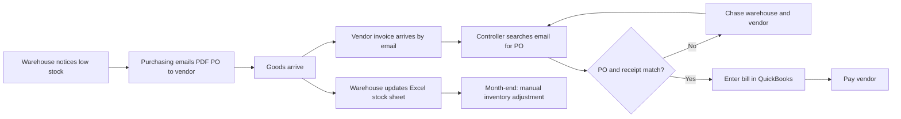
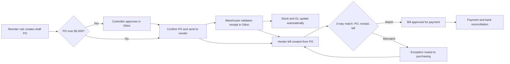

# Process Maps: Procure-to-Pay, Current State vs. Future State

> Fictional portfolio project. Diagrams use Mermaid, which GitHub renders automatically.

## Current state: purchasing in QuickBooks + email

**Pain points:** no approval before spend · stock updated in a separate file · invoice matching done by hand · inventory adjusted manually at close.

## Future state: purchasing in Odoo

**Improvements:** approval before spend · stock and accounting update together · automatic 3-way match · no manual month-end inventory adjustment.

## Month-end close: before and after

| Step | Current (days) | Future (days) | What changes |
|---|---|---|---|
| Bank reconciliation | 2 | 0.5 | Daily bank feeds |
| AP cut-off and accruals | 2 | 1 | Received-not-billed report from Odoo |
| Inventory reconciliation | 3 | 1 | Perpetual valuation posts to GL |
| AR review | 1 | 1 | No change |
| Reporting | 1 | 1.5 | Adds budget vs. actual review |
| **Total** | **9** | **5** | |
